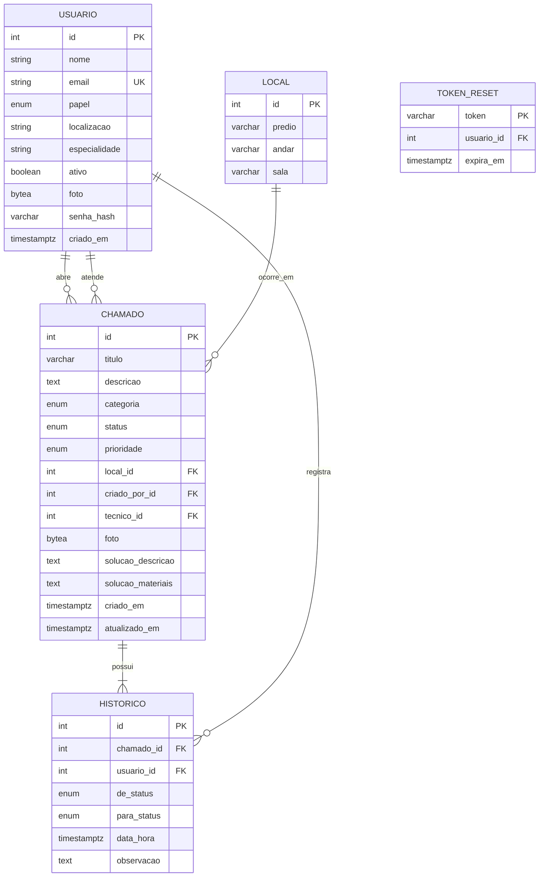

# Modelo de Dados

**Projeto:** Sistema de Gestão de Chamados de Manutenção Predial  
**Versão:** 1.0  
**Responsável:** Jefferson Felipe ([@isjustjefferson](https://github.com/isjustjefferson))

---

## 1. Introdução

Este documento descreve o modelo de dados do sistema, desde o minimundo até a implementação física no PostgreSQL. O objetivo é manter um banco normalizado, com integridade garantida por regras, chaves e restrições.

---

## 2. Minimundo

O sistema centraliza solicitações de manutenção predial.

- **Solicitante** abre um chamado informando local, categoria, descrição e foto (opcional).
- **Gestor** faz a triagem, define prioridade e atribui um técnico.
- **Técnico** atende, registra solução e materiais ao concluir.
- **Todo movimento** gera um histórico auditável com autor, data/hora e transição de status.
- **Perfis:** `SOLICITANTE`, `TECNICO`, `GESTOR`, `ADMINISTRADOR`.

**Regras principais:**

| Código | Regra |
| :--- | :--- |
| **RN01** | Solicitante só vê/interage com seus próprios chamados |
| **RN02** | Apenas Gestor define prioridade e atribui técnico |
| **RN03** | Técnico só altera chamados atribuídos a ele |
| **RN04** | Para concluir, é obrigatório informar solução e materiais |
| **RN07** | Não é permitido excluir usuário com chamados |

---

## 3. Modelo Conceitual (MER)

### Entidades

| Entidade | Descrição |
| :--- | :--- |
| `USUARIO` | Usuários com papel e dados de acesso |
| `LOCAL` | Local físico (prédio, andar, sala) |
| `CHAMADO` | Solicitação de manutenção |
| `HISTORICO` | Movimentações e transições de status |
| `TOKEN_RESET` | Tokens para redefinição de senha |

### Relacionamentos

| Relacionamento | Cardinalidade | Observação |
| :--- | :--- | :--- |
| Usuário (solicitante) → Chamado | 1:N (total) | Todo chamado tem um autor |
| Usuário (técnico) → Chamado | 1:N (parcial) | Pode estar sem técnico |
| Local → Chamado | 1:N (total) | Todo chamado tem um local |
| Chamado → Histórico | 1:N (total) | Mínimo 1 registro na abertura |
| Usuário → Histórico | 1:N (total) | Quem registrou a transição |
| Chamado → Solução | 1:1 (parcial) | Só existe se `CONCLUIDO` |



---

## 4. Modelo Lógico

Tabelas normalizadas em 3ª Forma Normal:

| Tabela | Chave | Observação |
| :--- | :--- | :--- |
| `usuarios` | `id` (PK), `email` (UNIQUE) | `papel` define o perfil. `localizacao`, `especialidade` conforme papel |
| `locais` | `id` (PK) | Normaliza `predio/andar/sala` evitando repetição |
| `chamados` | `id` (PK) | `solucao_descricao`/`solucao_materiais` são opcionais. Só exigidos se `CONCLUIDO` |
| `historicos` | `id` (PK) | Guarda `de_status` e `para_status` para manter histórico imutável |
| `tokens_reset` | `token` (PK) | Armazena tokens de recuperação |

---

## 5. Modelo Físico (PostgreSQL)

### 5.1 Domínios ENUM

```sql
CREATE TYPE papel       AS ENUM ('SOLICITANTE','TECNICO','GESTOR','ADMINISTRADOR');
CREATE TYPE status      AS ENUM ('AGUARDANDO_APROVACAO','REVISADO','EM_ANDAMENTO','CONCLUIDO');
CREATE TYPE prioridade  AS ENUM ('BAIXA','MEDIA','ALTA','CRITICA');
CREATE TYPE categoria   AS ENUM ('ELETRICA','HIDRAULICA','CLIMATIZACAO','MOBILIARIO','ESTRUTURAL','OUTROS');
```

### 5.2 Integridade Referencial

| Chave | ON DELETE | Motivo |
| :--- | :--- | :--- |
| `chamados.criado_por_id` → `usuarios` | `RESTRICT` | Não excluir autor (RN07) |
| `chamados.tecnico_id` → `usuarios` | `SET NULL` | Manter chamado mesmo sem técnico |
| `chamados.local_id` → `locais` | `RESTRICT` | Evitar remover local em uso |
| `historicos.chamado_id` → `chamados` | `CASCADE` | Histórico pertence ao chamado |
| `historicos.usuario_id` → `usuarios` | `RESTRICT` | Não deixar histórico órfão |
| `tokens_reset.usuario_id` → `usuarios` | `CASCADE` | Limpar tokens ao remover usuário |

### 5.3 Regra RN04

```sql
ALTER TABLE chamados
ADD CONSTRAINT chamados_conclusao_incompleta_chk
CHECK (
  status <> 'CONCLUIDO'
  OR (
    solucao_descricao IS NOT NULL
    AND solucao_materiais IS NOT NULL
    AND btrim(solucao_descricao) <> ''
    AND btrim(solucao_materiais) <> ''
  )
);
```

> Os `IS NOT NULL` são obrigatórios: em `CHECK`, `NULL` não reprova. Só `FALSE` faz o teste falhar.

### 5.4 Índices

Criados para otimizar filtros e histórico:

```sql
-- Filtros
CREATE INDEX chamados_status_idx     ON chamados (status);
CREATE INDEX chamados_categoria_idx  ON chamados (categoria);
CREATE INDEX chamados_prioridade_idx ON chamados (prioridade);
CREATE INDEX chamados_local_idx      ON chamados (local_id);
CREATE INDEX chamados_criado_por_idx ON chamados (criado_por_id);
CREATE INDEX chamados_tecnico_idx    ON chamados (tecnico_id);
CREATE INDEX chamados_criado_em_idx  ON chamados (criado_em DESC);

-- Histórico ordenado
CREATE INDEX historicos_chamado_data_idx ON historicos (chamado_id, data_hora DESC, id DESC);

-- Outros
CREATE INDEX tokens_reset_expira_idx ON tokens_reset (expira_em);
CREATE INDEX usuarios_ativo_idx      ON usuarios (ativo);
```

### 5.5 Observações

- **Datas:** `timestamptz` (armazenado em UTC, exibido no fuso da sessão)
- **Fotos:** `bytea` no banco, convertidas para base64 na API
- **IDs:** `GENERATED ALWAYS AS IDENTITY`. Ao carregar seed com IDs fixos, usar `OVERRIDING SYSTEM VALUE` e ajustar sequência com `setval`
- **Reexecução:** Os scripts são idempotentes (usam `IF NOT EXISTS` / consultas ao catálogo)

---

## 6. Implantação

Para provisionar o banco, veja [README.md](./README.md).

**Ordem aplicada pelos scripts:**

1. `01_tipos.sql` → ENUMs principais
2. `01b_tipos_despesas.sql` → ENUMs de despesas/anexos
3. `02_tabelas.sql` → Tabelas principais
4. `02b_despesas_tabelas.sql` → `despesas` e `anexos_despesa`
5. `03_chaves_estrangeiras.sql` → FKs principais
6. `03b_chaves_despesas.sql` → FKs de despesas
7. `04_check_rn04.sql` → CHECK
8. `05_indices.sql` → Índices principais
9. `05b_indices_despesas.sql` → Índices de despesas

**Validação realizada:** Schema testado em PostgreSQL 18 com todos os cenários (reexecução, CHECK, FKs, ENUMs e `setval`). Agora cobre também `despesas` e `anexos_despesa`, com `unidade`/`setor` em `usuarios` e `classificacao` JSONB em `chamados` para manter compatibilidade com o contrato atual.
